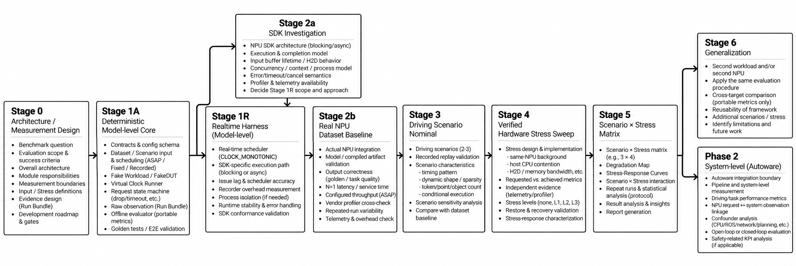

# SDV-BMT — Model-level Accelerator Benchmark Core

## What SDV-BMT is

SDV-BMT runs one model workload on an accelerator (the device under test, DUT) under a planned request
schedule and records **evidence**: what was planned, what was actually realized, and exactly how each number
was measured. Metrics are computed afterwards from that evidence alone.

The long-term targets are automotive NPUs. Version 0.1 validates the measurement system on an NVIDIA GPU, the
first *reference accelerator*: v0.1.0 with YOLOX-S, v0.1.2 with eight reference models (five YOLOX detectors on
COCO, three DeepLabV3+ segmenters on Cityscapes). GPU results are not NPU results, are not a GPU ranking, and predict nothing about
NPU timing.

## Research question

> Can a Model-level benchmark distinguish the planned configuration from the realized execution conditions,
> keep its measurement boundaries valid, and localize observed latency variation — without attributing a
> difference beyond what the evidence supports?

The guiding rules: *Control what is planned. Verify what is realized. Localize what changed. Do not attribute
beyond the evidence.* — *No attributed delta without validated factor isolation.* — *A configured condition and a
realized condition are not assumed to be identical.*

## Architecture

```text
Python control plane            plan loading, strict validation, preflight, identities
        │  resolved run specification (phase protocol, one native process per run)
        ▼
C++ native measurement plane    realtime issuer, admission (N=1, queue 0, drop_new), timeouts,
                                host-clock timestamps, DUT backend (fake or NVIDIA)  →  facts only
        │  append-only evidence bundle: events, outputs, input items, manifest, realization evidence
        ▼
Python evaluation plane         Model-level Metric Set v1.1, task quality, Design / Realization /
                                Measurement Guards, analysis tools
```

- **C++ records facts; Python computes meaning.** The native runner computes no metric; percentiles,
  deadlines, task quality and statistics are evaluated in Python from the bundle only.
- No Python runs in the per-request measured path; the native issuer spins on the host monotonic clock.
- Portable semantics are kept apart from vendor observation: CUDA, cuDNN, NVML and NVTX appear only in
  `native/src/nvidia/`, `src/sdv_bmt/dut/nvidia/` and namespaced evidence keys (`nvidia.*`).
- Timeouts follow the Stage 1A semantics on real time: events are decided in the order of their semantic
  timestamps (arrival `t_sched`, timeout `t_submit_begin + request_timeout_ns`, completion `t_complete`); the tie
  order completion → timeout → arrival applies only to equal timestamps; a timed-out request keeps the slot until
  its late completion.

## Model-level Metric Set v1.1

Catalog `sdv-bmt-model-metric-set-v1.1` (default since v0.1.2): the 91 metrics of Metric Set v1
(`sdv-bmt-model-metric-set-v1`, still selectable) plus two segmentation-quality metrics, computed by
`sdv-bmt evaluate` from a bundle. Every result carries its layer and its population (planned / completed /
sample count, coverage).

| layer | metrics (examples) |
|---|---|
| performance | `bmt.request_completion.*`, `bmt.dut_service.*`, `bmt.output_ready.*` (p50 / p90 / p99 / `max_observed`), `bmt.offered_rate`, `bmt.achieved_completion_rate`, `bmt.closed_loop_completion_rate`, state counts and rates |
| timeliness | `bmt.deadline.{completion,output_ready}_miss_{count,rate}`, `bmt.required_rate`, `bmt.required_rate_met` |
| task quality | detection: `quality.detection.coverage`, `quality.detection.conditional.{ap, ap50, ap75, ap_small, ap_medium, ap_large, ar1, ar10, ar100, precision, recall, f1, tp_count, fp_count, fn_count, fp_per_image, fn_per_gt}`; segmentation (v1.1): `quality.segmentation.coverage`, `quality.segmentation.conditional.miou` |
| diagnostics | `bmt.issue_lag.*`, `bmt.submit.*`, `bmt.post_submit.*`, `bmt.output_stage.*`, `bmt.h2d.*`, `bmt.device_execution_bracket.*`, `bmt.d2h.*`, `bmt.output.identity_rate` |
| validity / evidence | `data.item_count`, `data.annotation_coverage`, `data.integrity.*_verified_rate`, `data.traceability.complete` |

Rules: nearest-rank percentiles; a p99 needs at least 100 samples, otherwise `invalid(insufficient_samples)`;
planned percentiles count non-completed requests as +∞ and are `censored` (report-only) when the rank lands
there; a non-valid result never carries a number; DUT-service is not device execution time and the device
execution bracket is not device busy time; deadlines are evaluation parameters, not FTTI; task quality is
*conditional* on completed outputs and always reported with its coverage; output identity is a determinism
diagnostic, not accuracy. Definitions: [`docs/metrics_catalog.md`](docs/metrics_catalog.md) §8–9 (Korean).

## Evidence and validity

- A run writes an append-only bundle: `run_spec.json`, `input_items.jsonl`, `events.jsonl`, `stress.jsonl`,
  `outputs.bin`, and — when the workload declares a task-quality evaluator — `quality_reference.jsonl` with the
  frozen ground truth; `manifest.json` (written last) records every raw file's SHA-256, the identities, the
  measurement boundary and one realization-evidence record per realized condition (`observed`,
  `self_reported`, `virtual`, `not_observable`, `not_applicable`).
- Evaluation never modifies raw files and writes a new `evaluations/<eval_id>/`.
- `evaluate_contrast_validity` checks a pair of runs with three guards: **Design** (only the intended factor
  varied), **Realization** (the fixed conditions were realized equivalently, as far as observed), and
  **Measurement** (same boundary, catalog, protocol and evaluator). Missing evidence is never equivalence; a
  numeric difference is never an attributable factor effect unless all three pass. Guard results are structured
  validity results, not metrics.

Details: [`docs/architecture.md`](docs/architecture.md), [`docs/measurement_protocol.md`](docs/measurement_protocol.md),
[`docs/evidence.md`](docs/evidence.md) (Korean).

## Reference implementation in v0.1.2

| part | status |
|---|---|
| deterministic core (virtual clock, FakeDUT) | MOCK; golden regression cases G-1..G-5 |
| realtime harness, fake native backend | MOCK; harness-floor and conformance tests |
| NVIDIA backend | ACTUAL on one reference GPU (NVIDIA RTX PRO 6000 Blackwell Max-Q Workstation Edition): CUDA 13.0 (headers, NVRTC, driver API, NVML), cuDNN 9.1 plan executor with a pinned algorithm table, CUDA event brackets, optional Nsight Systems cross-check |
| detection workloads | YOLOX-Tiny (416 × 416), S, M, L, X (official ONNX, converted offline to cuDNN plans) on the first 1,000 COCO val2017 images; COCO bbox quality |
| segmentation workloads (v0.1.2) | DeepLabV3+ R-18, R-50, R-101 (mmsegmentation Cityscapes checkpoints, exported to ONNX and converted offline to cuDNN plans) on the 500 Cityscapes val images at 2048 × 1024; Cityscapes 19-class mIoU |
| all workloads | FP32, batch 1, N = 1 |

Before a run starts, the runner rejects a plan whose fixed-rate deadline does not follow its rate, an input whose
preprocessing contract differs from the workload's, a native runner not built from the current native sources, a
cuDNN plan that reads or writes outside its buffers or leaves part of the task output unwritten, and a misaligned
timing offset.

## Quick start (no GPU needed)

```bash
python3 -m venv .venv
.venv/bin/pip install -e ".[dev]"          # runtime: PyYAML; dev: pytest
make -C native portable                    # fake native runner + C++ unit tests (g++, no CUDA)

# deterministic core (MOCK, virtual clock)
.venv/bin/sdv-bmt validate configs/experiments/g2-recorded-scenario-overload.yaml
.venv/bin/sdv-bmt run      configs/experiments/g2-recorded-scenario-overload.yaml --out runs/demo
.venv/bin/sdv-bmt evaluate runs/demo/g2-recorded-scenario-overload/<run_id>

# realtime harness with the fake native backend (MOCK, host clock)
.venv/bin/sdv-bmt run configs/experiments/r1-fake-native-harness-floor.yaml --out runs/demo
```

The realtime example pins the native runner (`realtime.cpu_affinity`) to CPUs 0–15 and 32–47 of the
reference host; on a machine without those CPUs the run stops with `cpu_affinity_not_realized`. Edit that
list to CPUs available on your machine to run it locally.

`sdv-bmt evaluate` uses Metric Set v1.1; `--catalog sdv-bmt-model-metric-set-v1` reproduces v0.1.0
evaluations and `--catalog bmt-portable-v1-stage1a` those of the earlier Stage 1A catalog. `--eval-config FILE` overrides the deadline and may set `required_rate_hz` and
`quality_operating_point`. Exit codes: `0` success, `1` run executed but failed, `2` rejected.

## Testing

| scope | command | GPU tests |
|---|---|---|
| CPU / portable (also GitHub Actions) | `make -C native portable && native/build/sdv-bmt-native-tests` and `SDV_BMT_MAKE_TARGETS=portable .venv/bin/python -m pytest -q -rs` | reported NOT RUN (skipped), never passed |
| local GPU release validation | `make -C native && native/build/sdv-bmt-native-tests` and `.venv/bin/python -m pytest -q` | run on the GPU named by UUID in `configs/duts/nvidia-*.yaml` and `tests/device/` |

The NVIDIA build expects CUDA 13.0 in `/usr/local/cuda-13.0` and cuDNN 9 from the pip package
`nvidia-cudnn-cu12`; override with `make -C native CUDA_HOME=... CUDNN_ROOT=...`. Tests that need the local COCO
subset or the Cityscapes val set, the model files or local evidence bundles skip as NOT RUN when those are
absent.

## Reproducing the GPU reference result

Large or third-party artifacts are not in the repository (`.gitignore`: `models/`, `datasets/`, `runs/`).

```bash
# 1. model (Apache-2.0, 35,858,002 bytes)
mkdir -p models/yolox-s
curl -L -o models/yolox-s/yolox_s.onnx \
    https://github.com/Megvii-BaseDetection/YOLOX/releases/download/0.1.1rc0/yolox_s.onnx
sha256sum models/yolox-s/yolox_s.onnx   # c5c2d13e59ae883e6af3b45daea64af4833a4951c92d116ec270d9ddbe998063

# 2. cuDNN plan + float32 weights (stdlib, deterministic; SHA-256 pinned in configs/workloads/yolox-s-coco-v1*.yaml)
python3 tools/stage2b_g_real/build_yolox_plan.py models/yolox-s/yolox_s.onnx models/yolox-s/yolox_s

# 3. COCO subset: first 1,000 val2017 images by image id, decoded once to PPM (needs Pillow)
python3 tools/stage2b_g_real/build_coco_subset.py --images $COCO_ROOT/val2017 \
    --annotations $COCO_ROOT/annotations/instances_val2017.json --count 1000 --out datasets/coco-val2017-first1000

# 4. set your GPU's UUID in configs/duts/nvidia-rtx-pro-6000-gpu0-cudnn-yolox-s.yaml (device:), then
make -C native
.venv/bin/sdv-bmt run configs/experiments/br-yolox-30hz-msv1.yaml --out runs/gpu
.venv/bin/sdv-bmt evaluate runs/gpu/br-yolox-30hz-msv1/<run_id>
```

The input specs pin the subset index by SHA-256. It was built with Pillow 11.1.0 / libjpeg-turbo 3.1.0; another
JPEG decoder can produce different pixels and therefore a different digest, which the run rejects.

### Other v0.1.2 models

- **YOLOX-Tiny, M, L, X**: download `yolox_{tiny,m,l,x}.onnx` from the same YOLOX release (sizes and SHA-256 in
  [`THIRD_PARTY_NOTICES.md`](THIRD_PARTY_NOTICES.md) and `configs/workloads/yolox-*-coco-v1.yaml`), convert each
  with step 2 into `models/yolox-<model>/yolox_<model>`, then run `configs/experiments/yolox-<model>-baseline.yaml`.
  `python3 tools/yolox_family/make_experiments.py --rate-hz R` rewrites all five baseline plans for another rate.
- **DeepLabV3+ R-18 / R-50 / R-101**: download the mmsegmentation Cityscapes checkpoints (URLs and SHA-256 in
  `THIRD_PARTY_NOTICES.md`), export with `tools/deeplab_family/export_onnx.py` (needs PyTorch and onnx; offline
  only; the reference export used PyTorch 2.4.1 and onnx 1.17.0, and other versions can produce a different file)
  and convert with `tools/deeplab_family/build_deeplab_plan.py`. Cityscapes requires a registered account
  and may not be redistributed: download `leftImg8bit_trainvaltest.zip` and `gtFine_trainvaltest.zip` yourself and
  build the val input with `tools/deeplab_family/build_cityscapes_val.py`. Then run
  `configs/experiments/deeplabv3plus-<model>-baseline.yaml` (2 Hz). Each tool's module docstring gives its exact
  command line.
- Set your GPU's UUID in the model's `configs/duts/nvidia-rtx-pro-6000-gpu0-cudnn-<model>.yaml` as in step 4.
  The configurations pin the plan, the weights and the input index by SHA-256, so a different file is rejected
  before the run.

## Example: canonical GPU result (v0.1.0 reference evidence)

YOLOX-S on the first 1,000 COCO val2017 images, one NVIDIA RTX PRO 6000 Blackwell Max-Q Workstation Edition, fixed rate 30 Hz, N = 1 (run `run-20261009T044411Z-003b1415f3b3`, no foreign GPU process, shared host). Latencies in µs, nearest-rank over the 1,000 completed requests:

| metric | p50 | p90 | p99 | max_observed |
|---|---:|---:|---:|---:|
| request completion | 4,876.2 | 5,390.7 | 6,529.0 | 9,423.0 |
| DUT service | 4,874.4 | 5,355.3 | 6,397.0 | 7,634.3 |
| output ready | 5,066.4 | 5,678.3 | 6,832.9 | 10,380.3 |
| device execution bracket (device clock) | 4,490.6 | 4,834.4 | 5,500.5 | 7,008.4 |

Completed 1,000 / 1,000, no drops, timeouts or errors; completion and output-ready deadline misses 0 (deadline 33.333333 ms); achieved completion rate 30.025/s at an offered 30.000/s. COCO bbox quality (conditional, coverage 1.0): AP 0.42892, AP50 0.61348, AP75 0.46807; at score ≥ 0.5 / IoU ≥ 0.5 precision 0.83621, recall 0.50288. This is a reference-accelerator result: not an NPU result, not a ranking, not a worst-case bound. Full table, setup, earlier runs, guard results and limitations: [`docs/results/v0.1.0-gpu-reference-result.md`](docs/results/v0.1.0-gpu-reference-result.md).

## v0.1.2 reference models

Same GPU, FP32, batch 1, N = 1, five fixed-rate runs per model (min–max over the runs). Every run completed all
requests with no drops, timeouts, errors or deadline misses, and its outputs were byte-identical to the model's
golden capture.

| model | data | rate | DUT-service p50 (ms) | DUT-service max_observed (ms) | quality |
|---|---|---|---:|---:|---|
| YOLOX-Tiny | COCO val2017, first 1,000 | 30 Hz | 2.23–2.30 | 2.44–2.92 | AP 0.3437 |
| YOLOX-S | COCO val2017, first 1,000 | 30 Hz | 4.36–4.38 | 4.45–5.65 | AP 0.4289 |
| YOLOX-M | COCO val2017, first 1,000 | 30 Hz | 9.75–10.57 | 9.86–10.79 | AP 0.4948 |
| YOLOX-L | COCO val2017, first 1,000 | 30 Hz | 16.18–16.22 | 16.41–18.06 | AP 0.5294 |
| YOLOX-X | COCO val2017, first 1,000 | 30 Hz | 26.76–28.06 | 26.85–29.56 | AP 0.5327 |
| DeepLabV3+ R-18 | Cityscapes val, 500 | 2 Hz | 25.51–25.86 | 27.38–29.65 | mIoU 0.7676 |
| DeepLabV3+ R-50 | Cityscapes val, 500 | 2 Hz | 114.27–114.76 | 122.43–129.57 | mIoU 0.7985 |
| DeepLabV3+ R-101 | Cityscapes val, 500 | 2 Hz | 165.64–166.45 | 175.14–176.22 | mIoU 0.8087 |

Models are compared side by side; differences between models are not attributed to a cause. Each family was
measured on one day, so these YOLOX-S timings are not compared with the v0.1.0 run above. Numeric checks against
ONNX Runtime and the official implementations, the replay-rate rule, operating records and limitations:
[`docs/results/v0.1.2-gpu-reference-result.md`](docs/results/v0.1.2-gpu-reference-result.md).

## Repository layout

| path | content |
|---|---|
| `src/sdv_bmt/` | Python core: contracts, input providers, workloads, DUT adapters, runner, evidence, metrics, CLI |
| `native/` | C++ native measurement plane (`src/common`, `src/fake`, `src/nvidia`) and its unit tests |
| `configs/` | experiment plans, inputs, workloads, DUT configs, stress specs, output references, small fixtures |
| `tests/` | unit, conformance, golden, architecture, e2e, native and device tests |
| `tools/` | offline asset preparation, cross-checks and analysis (outside the core's code identity) |
| `docs/` | architecture, measurement protocol, evidence, metric catalog (Korean), `docs/results/` and `docs/release-notes/` (English) |
| `docs/design/` | Stage 0 design basis (v03) and Stage 1A implementation authorization, public editions (Korean) |

## Roadmap

v0.1.0 covers the deterministic core, the native realtime harness, the NVIDIA GPU reference backend, the real
YOLOX-S / COCO baseline and Model-level Metric Set v1. v0.1.2 adds the YOLOX family, DeepLabV3+ segmentation on
Cityscapes and Metric Set v1.1 on the same GPU reference track. Planned next, each behind its own review gate: NPU SDK
and observability investigation (Stage 2a-N), NPU realtime harness (1R-N) and NPU baseline (2b-N); later the
Driving Scenario stage, hardware stress, and the Scenario × Stress matrix.

Not in v0.1.x: NPU integration, driving scenarios, stress sweeps, system-level (Autoware) evaluation, WCET or
FTTI claims, functional-safety compliance claims, calibration, energy per inference, DRAM bandwidth, AI error
rates per hour or km, TTC / PET / DST, SPFM / LFM / PMHF / FIT.



*Stages 0 and 1A are complete; 2a, 1R and 2b were carried out on the NVIDIA GPU reference track in v0.1.0 and extended to eight models in v0.1.2; the NPU track (2a-N, 1R-N, 2b-N) is next.*
