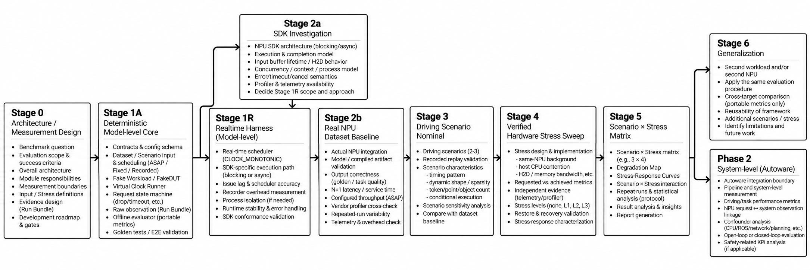

# SDV-BMT — Model-level Accelerator Benchmark Core

## What SDV-BMT is

SDV-BMT is a benchmark for AI accelerators at the level of one model workload. It runs a model on a device under
test (DUT) under a planned request schedule and records **evidence**: what was planned, what was actually
realized, and exactly how each number was measured. Metrics are computed afterwards from that evidence alone.

Most benchmarks report a number. SDV-BMT reports a number together with the conditions it was measured under,
whether those conditions were actually met, and whether a difference between two runs may be attributed to a
cause. It was designed with software-defined-vehicle (SDV) perception and language workloads in mind, but the
core is device- and vendor-neutral.

## Research question

> Can a Model-level benchmark distinguish the planned configuration from the realized execution conditions,
> keep its measurement boundaries valid, and localize observed latency variation — without attributing a
> difference beyond what the evidence supports?

The guiding rules: *Control what is planned. Verify what is realized. Localize what changed. Do not attribute
beyond the evidence.* — *No attributed delta without validated factor isolation.* — *A configured condition and a
realized condition are not assumed to be identical.*

## Key features

| feature | what it gives you |
|---|---|
| **Planned vs. realized** | Every condition in the plan (rate, affinity, device settings, inputs) is checked against what actually happened, and each check is recorded as `observed`, `self_reported`, `virtual`, `not_observable` or `not_applicable`. A condition that could not be observed is never treated as met. |
| **Evidence first, metrics later** | A run writes an append-only, hash-sealed evidence bundle. Metrics are recomputed from the bundle at any time, with any supported catalog, without touching the raw data. |
| **Low-overhead native measurement** | A C++ measurement plane issues requests in real time on the host monotonic clock; no Python runs in the per-request measured path. Its own overhead (issue lag, harness floor) is measured and reported. |
| **Clear measurement boundaries** | Request completion, DUT service, output ready and the device execution bracket are separate metrics with separate definitions, so host-side and device-side time are never mixed. |
| **Performance, timeliness and quality together** | One run yields latency distributions, deadline misses, achieved rates and task quality (detection AP, segmentation mIoU, 3D-detection mAP / NDS), each with its population and coverage. |
| **Honest statistics** | Nearest-rank percentiles, a minimum sample count per percentile, censoring of dropped or timed-out requests, and no number for an invalid result. |
| **Attributable A/B comparison** | Three guards (Design, Realization, Measurement) decide whether the difference between two runs may be attributed to the one factor that was changed. |
| **Strict preflight** | Inconsistent plans, mismatched preprocessing, stale native builds, unpinned or modified model files and inputs are rejected before the run starts. |
| **Reproducible by construction** | Models, weights, inputs and executors are pinned by SHA-256; outputs can be checked byte for byte against a golden capture. |
| **Pluggable devices** | Each device backend lives in its own directory behind a portable contract; device-specific observations use namespaced evidence keys and never leak into the portable metrics. |
| **One command per model** | One command validates, runs, evaluates and writes a metric table for a model. |

## Architecture

```text
Python control plane            plan loading, strict validation, preflight, identities
        │  resolved run specification (phase protocol, one native process per run)
        ▼
C++ native measurement plane    realtime issuer, admission control, timeouts,
                                host-clock timestamps, DUT backends (fake, NVIDIA GPU
                                reference, NPU backends)  →  facts only
        │  append-only evidence bundle: events, outputs, input items, manifest, realization evidence
        ▼
Python evaluation plane         Model-level Metric Set, task quality, Design / Realization /
                                Measurement Guards, analysis tools
```

- **C++ records facts; Python computes meaning.** The native runner computes no metric; percentiles,
  deadlines, task quality and statistics are evaluated in Python from the bundle only.
- **Portable semantics are kept apart from device observation.** Each backend appears only in its own
  directories (`native/src/<backend>/`, `src/sdv_bmt/dut/<backend>/`) and in its own namespaced evidence keys.
  A deterministic fake backend with a virtual clock ships with the core for testing without hardware.
- **Request admission is explicit**: in-flight limit, queue capacity and the policy when full (for example
  N = 1, queue 0, `drop_new`) are part of the plan and of the evidence.
- **Timeouts are decided on real time**: events are ordered by their semantic timestamps (arrival, timeout,
  completion); a timed-out request keeps its slot until its late completion.
- **LLM workloads** use a separate Python measurement plane with its own bundle format and catalog
  ([LLM benchmark](#llm-benchmark)).

## Request schedules

| mode | use |
|---|---|
| `fixed_rate` | offer requests at a set rate (for example a camera or LiDAR frame rate) and check deadlines against it |
| `asap` | issue the next request as soon as the previous one completes, to find closed-loop throughput |
| `recorded` | replay the timestamps of a recorded scenario, optionally at another speed |

A *run series* runs one dataset selection that is too large for a single run as consecutive ordinary runs (parts).
A part never splits a block of items that share a metadata value (for example a driving scene); the series is
evaluated as one result and is valid only if every part is valid.

## Model-level Metric Set

Catalog `sdv-bmt-model-metric-set-v1.1` (default): 93 metrics computed by `sdv-bmt evaluate` from a bundle.
`sdv-bmt-model-metric-set-v1.2` adds eight 3D-detection metrics. Every result carries its layer and its
population (planned / completed / sample count, coverage).

| layer | metrics (examples) |
|---|---|
| performance | `bmt.request_completion.*`, `bmt.dut_service.*`, `bmt.output_ready.*` (p50 / p90 / p99 / `max_observed`), `bmt.offered_rate`, `bmt.achieved_completion_rate`, `bmt.closed_loop_completion_rate`, state counts and rates |
| timeliness | `bmt.deadline.{completion,output_ready}_miss_{count,rate}`, `bmt.required_rate`, `bmt.required_rate_met` |
| task quality | detection: `quality.detection.conditional.{ap, ap50, ap75, …, precision, recall, f1}`; segmentation: `quality.segmentation.conditional.miou`; 3D detection: `quality.det3d.conditional.{map, nds, …}` — each with its coverage |
| diagnostics | `bmt.issue_lag.*`, `bmt.submit.*`, `bmt.post_submit.*`, `bmt.output_stage.*`, `bmt.h2d.*`, `bmt.device_execution_bracket.*`, `bmt.d2h.*`, `bmt.output.identity_rate` |
| validity / evidence | `data.item_count`, `data.annotation_coverage`, `data.integrity.*_verified_rate`, `data.traceability.complete` |

Rules: nearest-rank percentiles; a p99 needs at least 100 samples, otherwise `invalid(insufficient_samples)`;
planned percentiles count non-completed requests as +∞ and are `censored` (report-only) when the rank lands
there; a non-valid result never carries a number; DUT service is not device execution time and the device
execution bracket is not device busy time; deadlines are evaluation parameters, not FTTI; task quality is
*conditional* on completed outputs and always reported with its coverage; output identity is a determinism
diagnostic, not accuracy. Definitions: [`docs/metrics_catalog.md`](docs/metrics_catalog.md) §8–9 (Korean).

## Evidence and validity

- A run writes an append-only bundle: `run_spec.json`, `input_items.jsonl`, `events.jsonl`, `stress.jsonl`,
  `outputs.bin`, and — when the workload declares a task-quality evaluator — `quality_reference.jsonl` with the
  frozen ground truth; `manifest.json` (written last) records every raw file's SHA-256, the identities, the
  measurement boundary and one realization-evidence record per realized condition.
- Evaluation never modifies raw files and writes a new `evaluations/<eval_id>/`.
- `evaluate_contrast_validity` checks a pair of runs with three guards: **Design** (only the intended factor
  varied), **Realization** (the fixed conditions were realized equivalently, as far as observed), and
  **Measurement** (same boundary, catalog, protocol and evaluator). Missing evidence is never equivalence; a
  numeric difference is never an attributable factor effect unless all three pass. Guard results are structured
  validity results, not metrics.

Details: [`docs/architecture.md`](docs/architecture.md), [`docs/measurement_protocol.md`](docs/measurement_protocol.md),
[`docs/evidence.md`](docs/evidence.md) (Korean).

## Reference workloads

| task | models | data | quality |
|---|---|---|---|
| 2D detection | YOLOX-Tiny, S, M, L, X | COCO val2017, first 1,000 images | COCO bbox AP |
| semantic segmentation | DeepLabV3+ R-18, R-50, R-101 | Cityscapes val, 500 images at 2048 × 1024 | 19-class mIoU |
| 3D detection (LiDAR) | CenterPoint-Pillars | nuScenes: 162 mini-val samples, or all 6,019 val samples as a run series | nuScenes mAP / NDS |
| language | Llama 3.2 1B / 3B Instruct, Llama 3.1 8B Instruct | MMLU and synthetic speed inputs | MMLU accuracy |

Each workload has a fixed contract (preprocessing, input and output layout, evaluator) shared by every device
backend, so only the model execution differs between devices. Preprocessing that is not part of the measured path
(for example LiDAR sweep merging and voxelization) is done offline and pinned.

## GPU reference baseline

Every reference workload runs on an NVIDIA GPU, the *reference accelerator*. GPU results validate the
measurement system; they are not a GPU ranking and predict nothing about other accelerators.

| part | setup |
|---|---|
| device | one NVIDIA RTX PRO 6000 Blackwell Max-Q Workstation Edition |
| software | CUDA 13.0 (headers, NVRTC, driver API, NVML), cuDNN 9.1 plan executor with a pinned algorithm table, CUDA event brackets, optional Nsight Systems cross-check |
| detection | YOLOX-Tiny (416 × 416), S, M, L, X — official ONNX, converted offline to cuDNN plans |
| segmentation | DeepLabV3+ R-18, R-50, R-101 — mmsegmentation Cityscapes checkpoints, exported to ONNX and converted offline to cuDNN plans |
| 3D detection | CenterPoint-Pillars — mmdetection3d nuScenes checkpoint (pillar 0.2 m, circle NMS), exported to ONNX and converted offline to a cuDNN plan |
| LLM | Llama 3.2 1B / 3B Instruct and Llama 3.1 8B Instruct with vLLM |
| execution | batch 1, N = 1, FP32 |

### Canonical result (v0.1.0 reference evidence)

YOLOX-S on the first 1,000 COCO val2017 images, fixed rate 30 Hz, N = 1 (run `run-20261009T044411Z-003b1415f3b3`,
no foreign GPU process, shared host). Latencies in µs, nearest-rank over the 1,000 completed requests:

| metric | p50 | p90 | p99 | max_observed |
|---|---:|---:|---:|---:|
| request completion | 4,876.2 | 5,390.7 | 6,529.0 | 9,423.0 |
| DUT service | 4,874.4 | 5,355.3 | 6,397.0 | 7,634.3 |
| output ready | 5,066.4 | 5,678.3 | 6,832.9 | 10,380.3 |
| device execution bracket (device clock) | 4,490.6 | 4,834.4 | 5,500.5 | 7,008.4 |

Completed 1,000 / 1,000, no drops, timeouts or errors; completion and output-ready deadline misses 0 (deadline
33.333333 ms); achieved completion rate 30.025/s at an offered 30.000/s. COCO bbox quality (conditional, coverage
1.0): AP 0.42892, AP50 0.61348, AP75 0.46807; at score ≥ 0.5 / IoU ≥ 0.5 precision 0.83621, recall 0.50288. This
is a reference-accelerator result: not a ranking, not a worst-case bound. Full table, setup, earlier runs, guard
results and limitations: [`docs/results/v0.1.0-gpu-reference-result.md`](docs/results/v0.1.0-gpu-reference-result.md).

### Detection and segmentation models (v0.1.2)

Five fixed-rate runs per model (min–max over the runs). Every run completed all requests with no drops, timeouts,
errors or deadline misses, and its outputs were byte-identical to the model's golden capture.

| model | data | rate | DUT-service p50 (ms) | DUT-service max_observed (ms) | quality |
|---|---|---|---:|---:|---|
| YOLOX-Tiny | COCO val2017, first 1,000 | 30 Hz | 2.23–2.30 | 2.44–2.92 | AP 0.3437 |
| YOLOX-S | COCO val2017, first 1,000 | 30 Hz | 4.36–4.38 | 4.45–5.65 | AP 0.4289 |
| YOLOX-M | COCO val2017, first 1,000 | 30 Hz | 9.75–10.57 | 9.86–10.79 | AP 0.4948 |
| YOLOX-L | COCO val2017, first 1,000 | 30 Hz | 16.18–16.22 | 16.41–18.06 | AP 0.5294 |
| YOLOX-X | COCO val2017, first 1,000 | 30 Hz | 26.76–28.06 | 26.85–29.56 | AP 0.5327 |
| DeepLabV3+ R-18 | Cityscapes val, 500 | 2 Hz | 25.51–25.86 | 27.38–29.65 | mIoU 0.7676 |
| DeepLabV3+ R-50 | Cityscapes val, 500 | 2 Hz | 114.27–114.76 | 122.43–129.57 | mIoU 0.7985 |
| DeepLabV3+ R-101 | Cityscapes val, 500 | 2 Hz | 165.64–166.45 | 175.14–176.22 | mIoU 0.8087 |

Models are compared side by side; differences between models are not attributed to a cause. Each family was
measured on one day, so these YOLOX-S timings are not compared with the v0.1.0 run above. Numeric checks against
ONNX Runtime and the official implementations, the replay-rate rule, operating records and limitations:
[`docs/results/v0.1.2-gpu-reference-result.md`](docs/results/v0.1.2-gpu-reference-result.md).

### CenterPoint-Pillars

Fixed rate 20 Hz (the LiDAR sweep rate), deadline 50 ms. The measured path runs from the pillar input to the decoded
3D detections; the 10-sweep merge and the voxelization are built offline.

| scope | runs | DUT-service p50 (ms) | DUT-service max_observed (ms) | quality |
|---|---|---:|---:|---|
| nuScenes v1.0-mini, the four official-val scenes (162 samples) | 5 runs (min–max) | 10.42–10.45 | 10.54–10.64 | mAP 0.536228 / NDS 0.585987 |
| nuScenes val (6,019 samples) | 1 run series, 7 parts | 10.34 | 10.79 | mAP 0.480113 / NDS 0.584944 |

Every run completed all requests with no drops, timeouts, errors or deadline misses, and the mini runs' outputs were
byte-identical to the golden capture. The official mmdetection3d implementation on the same samples (CPU, the nine
nearest sweeps) gives mAP 0.536228 / NDS 0.585986 on mini and 0.480101 / 0.584938 on val. The mini and val scores
are not compared with each other, because the four mini scenes have a skewed class mix. The model zoo's published
mAP 48.70 / NDS 59.62 already differ for the official re-run; one known cause is that the official configuration
draws nine of the ten sweeps at random, which SDV-BMT fixes to the nine nearest. Numeric checks, the replay-rate
rule, the run-series details and limitations:
[`docs/results/centerpoint-pillars-gpu-reference-result.md`](docs/results/centerpoint-pillars-gpu-reference-result.md).

## NPU backends

The repository also includes backend implementations for automotive NPUs: native measurement-plane backends, DUT
adapters and offline build tools, plus an NPU path for the LLM benchmark. They use the same workload contracts,
datasets, evidence bundle and evaluation as the GPU reference; only the model execution differs. They need the
vendor's SDK, which is not part of this repository. Publishing NPU results is subject to each vendor's terms, so
only results cleared for publication appear in [`docs/results/`](docs/results/). The NPU backends are
experimental and may change within 1.x together with the vendor SDKs.

## Running a model (one command)

```bash
tools/run_model.sh list                       # the model names
tools/run_model.sh yolox-s --dry-run          # what would run (no device, nothing written)
REPS=1 R=runs/bench tools/run_model.sh yolox-s
```

One command validates the plan, runs `REPS` timed runs, evaluates them and writes the model's metric table
`$R/tables/<model>.metrics.csv` ([`docs/metric_table.md`](docs/metric_table.md)); the four representative metrics
are printed as a table. `tools/show_metrics.py` prints a metric table in a readable form. A name without a device
suffix runs on the GPU reference backend; a suffix selects another device backend. The script's header lists what
each backend needs.

## Quick start (no hardware needed)

```bash
python3 -m venv .venv
.venv/bin/pip install -e ".[dev]"          # runtime: PyYAML; dev: pytest
make -C native portable                    # fake native runner + C++ unit tests (g++ only)

# deterministic core (virtual clock)
.venv/bin/sdv-bmt validate configs/experiments/g2-recorded-scenario-overload.yaml
.venv/bin/sdv-bmt run      configs/experiments/g2-recorded-scenario-overload.yaml --out runs/demo
.venv/bin/sdv-bmt evaluate runs/demo/g2-recorded-scenario-overload/<run_id>

# realtime harness with the fake native backend (host clock)
.venv/bin/sdv-bmt run configs/experiments/r1-fake-native-harness-floor.yaml --out runs/demo
```

The realtime example pins the native runner (`realtime.cpu_affinity`) to CPUs 0–15 and 32–47 of the
reference host; on a machine without those CPUs the run stops with `cpu_affinity_not_realized` — an example of a
planned condition that was not realized. Edit that list to CPUs available on your machine to run it locally.

`sdv-bmt evaluate` uses Metric Set v1.1 by default; `--catalog` selects another catalog. `--eval-config FILE`
overrides the deadline and may set `required_rate_hz` and `quality_operating_point`. Exit codes: `0` success,
`1` run executed but failed, `2` rejected.

## Testing

| scope | command | GPU tests |
|---|---|---|
| portable (no hardware; also GitHub Actions) | `make -C native portable && native/build/sdv-bmt-native-tests` and `SDV_BMT_MAKE_TARGETS=portable .venv/bin/python -m pytest -q -rs` | reported NOT RUN (skipped), never passed |
| local GPU release validation | `make -C native && native/build/sdv-bmt-native-tests` and `.venv/bin/python -m pytest -q` | run on the GPU named by UUID in `configs/duts/nvidia-*.yaml` and `tests/device/` |

The NVIDIA build expects CUDA 13.0 in `/usr/local/cuda-13.0` and cuDNN 9 from the pip package
`nvidia-cudnn-cu12`; override with `make -C native CUDA_HOME=... CUDNN_ROOT=...`. Tests that need a device, a
dataset, model files or local evidence bundles that are not present are reported as NOT RUN (skipped), never as
passed. Golden regression cases G-1..G-5 cover the deterministic core; conformance tests cover the realtime harness
and each backend.

## Reproducing the GPU reference result

Large or third-party artifacts are not in the repository (`.gitignore`: `models/`, `datasets/`, `runs/`).

```bash
# 1. model (Apache-2.0, 35,858,002 bytes)
mkdir -p models/yolox-s
curl -L -o models/yolox-s/yolox_s.onnx \
    https://github.com/Megvii-BaseDetection/YOLOX/releases/download/0.1.1rc0/yolox_s.onnx
sha256sum models/yolox-s/yolox_s.onnx   # c5c2d13e59ae883e6af3b45daea64af4833a4951c92d116ec270d9ddbe998063

# 2. cuDNN plan + float32 weights (stdlib, deterministic; SHA-256 pinned in configs/workloads/yolox-s-coco-v1*.yaml)
python3 tools/stage2b_g_real/build_yolox_plan.py models/yolox-s/yolox_s.onnx models/yolox-s/yolox_s

# 3. COCO subset: first 1,000 val2017 images by image id, decoded once to PPM (needs Pillow)
python3 tools/stage2b_g_real/build_coco_subset.py --images $COCO_ROOT/val2017 \
    --annotations $COCO_ROOT/annotations/instances_val2017.json --count 1000 --out datasets/coco-val2017-first1000

# 4. set your GPU's UUID in configs/duts/nvidia-rtx-pro-6000-gpu0-cudnn-yolox-s.yaml (device:), then
make -C native
.venv/bin/sdv-bmt run configs/experiments/br-yolox-30hz-msv1.yaml --out runs/gpu
.venv/bin/sdv-bmt evaluate runs/gpu/br-yolox-30hz-msv1/<run_id>
```

The input specs pin the subset index by SHA-256. It was built with Pillow 11.1.0 / libjpeg-turbo 3.1.0; another
JPEG decoder can produce different pixels and therefore a different digest, which the run rejects.

### Other GPU models

- **YOLOX-Tiny, M, L, X**: download `yolox_{tiny,m,l,x}.onnx` from the same YOLOX release (sizes and SHA-256 in
  [`THIRD_PARTY_NOTICES.md`](THIRD_PARTY_NOTICES.md) and `configs/workloads/yolox-*-coco-v1.yaml`), convert each
  with step 2 into `models/yolox-<model>/yolox_<model>`, then run `configs/experiments/yolox-<model>-baseline.yaml`.
  `python3 tools/yolox_family/make_experiments.py --rate-hz R` rewrites all five baseline plans for another rate.
- **DeepLabV3+ R-18 / R-50 / R-101**: download the mmsegmentation Cityscapes checkpoints (URLs and SHA-256 in
  `THIRD_PARTY_NOTICES.md`), export with `tools/deeplab_family/export_onnx.py` (needs PyTorch and onnx; offline
  only; the reference export used PyTorch 2.4.1 and onnx 1.17.0, and other versions can produce a different file)
  and convert with `tools/deeplab_family/build_deeplab_plan.py`. Cityscapes requires a registered account
  and may not be redistributed: download `leftImg8bit_trainvaltest.zip` and `gtFine_trainvaltest.zip` yourself and
  build the val input with `tools/deeplab_family/build_cityscapes_val.py`. Then run
  `configs/experiments/deeplabv3plus-<model>-baseline.yaml` (2 Hz). Each tool's module docstring gives its exact
  command line.
- **CenterPoint-Pillars**: download the mmdetection3d checkpoint
  `centerpoint_02pillar_second_secfpn_circlenms_4x8_cyclic_20e_nus_20220811_031844-191a3822.pth` (24,154,629 bytes,
  SHA-256 `191a38226d2ce990f26cc3f78c454310cc562d81d29e86d8ca8fa39c0a44215d`) from
  `https://download.openmmlab.com/mmdetection3d/v1.0.0_models/centerpoint/centerpoint_02pillar_second_secfpn_circlenms_4x8_cyclic_20e_nus/`.
  nuScenes requires a registered account (CC BY-NC-SA 4.0 and the nuScenes terms of use) and may not be
  redistributed: download v1.0-mini, and for the full val set the v1.0-trainval metadata and LiDAR archives,
  yourself. Build the input with `tools/centerpoint/build_nuscenes_input.py` (numpy and pyquaternion; for the full
  val set first `tools/centerpoint/extract_nuscenes_val.py`, which needs nuscenes-devkit), export with
  `tools/centerpoint/export_onnx.py` (PyTorch and onnx, offline only; the reference export used PyTorch 2.4.1, and
  other versions can produce a different file) and convert with `tools/centerpoint/build_centerpoint_plan.py`. Then
  run `configs/experiments/centerpoint-pillar02-mini-baseline.yaml` (20 Hz) or the run series
  `configs/experiments/centerpoint-pillar02-val-series.yaml`, and evaluate with
  `--catalog sdv-bmt-model-metric-set-v1.2` to get the 3D-detection metrics. Each tool's module docstring gives its
  exact command line.
- Set your GPU's UUID in the model's `configs/duts/nvidia-rtx-pro-6000-gpu0-cudnn-<model>.yaml` as in step 4.
  The configurations pin the plan, the weights and the input index by SHA-256, so a different file is rejected
  before the run.

The LLM path is described in [`docs/llm_benchmark.md`](docs/llm_benchmark.md).

## LLM benchmark

A separate Python measurement plane (`python -m sdv_bmt.llm`) benchmarks LLM serving runtimes with the same
evidence-first approach; on the GPU reference it runs the Llama models with vLLM. It uses its own bundle format and catalog (`sdv-bmt-llm-v1`), and its numbers are not
comparable with the Metric Set results above. Results are whole-system results (runtime + driver + device), shown
side by side and not attributed to a chip.

## Repository layout

| path | content |
|---|---|
| `src/sdv_bmt/` | Python core: contracts, input providers, workloads, DUT adapters, runner, evidence, metrics, CLI; `llm/` the LLM path |
| `native/` | C++ native measurement plane (`src/common`, `src/fake` and one directory per device backend) and its unit tests |
| `configs/` | experiment plans, inputs, workloads, DUT configs, stress specs, output references, small fixtures |
| `tests/` | unit, conformance, golden, architecture, e2e, native and device tests |
| `tools/` | offline asset preparation, cross-checks and analysis (outside the core's code identity) |
| `docs/` | architecture, measurement protocol, evidence, metric catalog (Korean), `docs/results/` and `docs/release-notes/` (English) |
| `docs/design/` | Stage 0 design basis and Stage 1A implementation authorization, public editions (Korean) |

## Stability and roadmap

Within 1.x the commands `validate`, `run` and `evaluate` with their exit codes, the configuration file formats
(fields are only added), the evidence bundle format, the metric definitions of Metric Set v1, v1.1 and v1.2, and the
metric table columns are kept; a change that breaks them is 2.0. Device adapters, the LLM path and the tools are
experimental and may change within 1.x.

Version history: v0.1.0 covered the deterministic core, the native realtime harness, the GPU reference backend,
the real YOLOX-S / COCO baseline and Model-level Metric Set v1. v0.1.2 added the YOLOX family, DeepLabV3+
segmentation on Cityscapes and Metric Set v1.1. v1.0 adds CenterPoint-Pillars with run series and Metric Set v1.2,
the LLM path, the NPU backends, the metric table and one-command runs.

Planned next, each behind its own review gate: 1.1 measurement extensions for result attribution (planned earlier
as "v0.2"), then the Driving Scenario stage, hardware stress, and the Scenario × Stress matrix.

Not in v1.0: driving scenarios, stress sweeps, system-level (Autoware) evaluation, WCET or FTTI claims,
functional-safety compliance claims, calibration, energy per inference, DRAM bandwidth, AI error rates per hour or
km, TTC / PET / DST, SPFM / LFM / PMHF / FIT.



*Stages 0 and 1A are complete; 2a, 1R and 2b were carried out on the GPU reference track in v0.1.0 and v0.1.2 and
on NPU backends in v1.0; the measurement extensions (1.1) and the Driving Scenario stage are next.*
